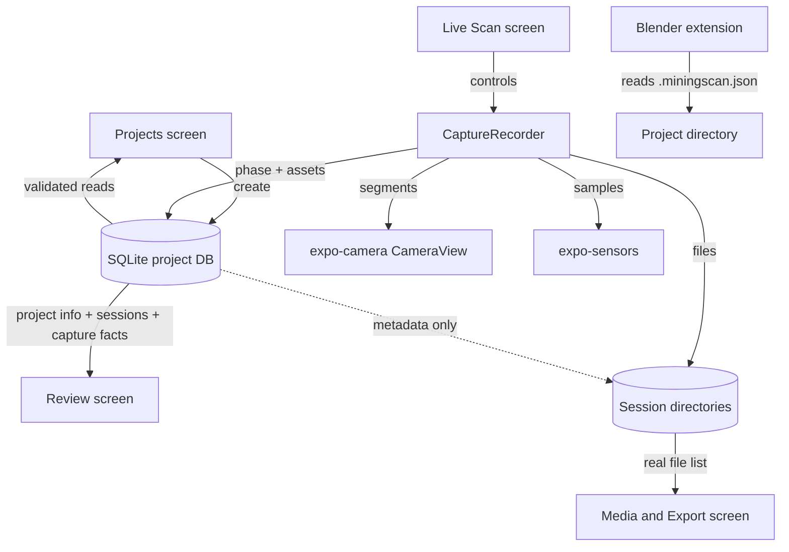

# Architecture — Stages 1–3 (planning)

Underground Mining Scanner. Stage 1 laid the offline data foundation; Stage 2
delivered real capture (camera video + sensor streams); the Stage 2.1 audit
corrected the operation registry and defined the first reconstruction
contracts; the Stage 3 planning correction separated tracking, trajectory
generation, point-cloud reconstruction, registration and fusion into distinct
operations and defined the full dependency chain. **Nothing yet reconstructs
or measures anything** — every such component reports itself as unavailable
until it is real.

## Design principles

1. **Offline first.** Projects live in on-device SQLite; point clouds and
   meshes live as files on disk. No server, no cloud, no accounts.
2. **Honesty over demos.** No fabricated scan data, measurements, progress
   bars or accuracy figures. Unimplemented functionality says so, explicitly,
   in the UI.
3. **Capability detection is tri-state.** A sensor is `true` (verified by a
   real API probe), `false` (verified absent) or `null` (not probed). The UI
   renders `null` as UNKNOWN — never as a guess.
4. **Databases store metadata only.** Binary assets are files; the database
   indexes them (path, size, format, provenance) but never embeds them.
5. **Modest hardware.** Target: ordinary Windows laptops with 8 GB RAM and
   Blender 5.1 for the desktop side; mid-range phones for the capture side.
   No LiDAR, depth sensor or GPU workstation is assumed.

## Components

```
mining-scanner/
├── app/                  Expo Router screens (4 tabs, Stage 1 UI)
├── src/
│   ├── models/           zod schemas — single source of truth for records
│   ├── database/         expo-sqlite layer + repositories
│   ├── services/         capability detection (honest nulls)
│   └── engine/           engine seams: ScannerEngine, reconstruction
│                         interfaces (unavailable), operation registry
├── blender/addons/       Blender 5.x extension (panels, operators, parser)
├── schemas/              18 JSON Schema (draft 2020-12) files + the
│                         machine-readable operation registry, shared
├── tests/mobile/         bun test — pure model tests, run off-device
└── tests/python/         unittest — schemas, metadata parser, add-on statics
```

### Mobile app (Expo / React Native / TypeScript)

- **Models** (`src/models/models.ts`): zod schemas mirroring `schemas/*.schema.json`.
  Pure TypeScript with zero React Native imports so they run under `bun test`.
- **Database** (`src/database/db.ts`): `openDatabaseAsync`, WAL mode, foreign
  keys ON, versioned `MIGRATIONS` array tracked in a `_migrations` table.
- **Repository** (`src/database/project-repository.ts`): all project / session
  / asset / operation SQL. Every row read back is zod-validated; a corrupt row
  raises instead of silently displaying garbage.
- **Engine seams** (`src/engine/`): `ScannerEngine` with an explicit
  unavailable implementation; the Stage 3 reconstruction interfaces
  (`reconstruction.ts`) whose only implementation rejects every call; and
  the operation registry (`operations.ts`) — the single source of truth for
  operation names, stages, dependencies, failure modes, provenance
  requirements and implementation status, mirrored in
  `schemas/operations.registry.json` and enforced by tests. The Stage 1
  `ScanAssetStore` placeholder was removed in the Stage 2.1 audit; the
  Stage 3 planning correction deprecated `frame_registration` (split into
  tracking / trajectory / reconstruction / registration / fusion).
- **Screens**: Projects (dashboard, create/list), Live Scan (capability probe
  with UNKNOWN verdicts), Review (project + session viewer, placeholder 3D
  viewport), Media & Export (all formats labelled PLANNED).

### Blender extension (`blender/addons/mining_scanner_tools`)

Blender 4.2+ extension (manifest format), targeting the operator's Blender
5.1. Panels read project metadata from a `.miningscan.json` file in the
project directory; operators that would import scans or analyse meshes report
`CANCELLED` with a `WARNING` — they are not implemented yet.

### Shared contracts

`schemas/*.schema.json` (draft 2020-12) are the language-neutral definitions.
The TypeScript zod schemas and the Python parser both implement them; the
JSON Schemas are the referee when the two disagree.

## Data flow (Stage 2)



The dashed path (database → project directory) is the contract later stages
will use: the app writes metadata and asset files into a per-project
directory; the Blender extension reads the same directory. Stage 2 now
writes real capture data into that tree; the Blender side still reads
project metadata only.

## Coordinate and unit convention (project-wide)

- Units: **metres**.
- Convention: **right-handed, +X east, +Y north, +Z up, local origin**.
- Projects are **not geo-referenced**. A geographic transform, if ever added,
  will be an explicit, separately stored object — never inferred.
- Timestamps: ISO 8601, UTC or explicit offset.
- Identifiers: `MS-` projects, `SES-` sessions, `PC-` point clouds,
  `MSH-` meshes, `OP-` operations, `JOB-` extraction jobs, `FRM-` frames,
  `CAL-` calibrations — each plus 8 hex characters.

## What is deliberately NOT here yet

Visual tracking, trajectory generation, point-cloud reconstruction,
registration, fusion, mesh reconstruction, tunnel-axis extraction,
cross-section or convergence analysis, export file writing, cloud sync.
Each has a defined operation in the registry (`src/engine/operations.ts`,
all NOT_IMPLEMENTED), a data contract in `schemas/*.schema.json`, and an
explicit unavailable seam in `src/engine/reconstruction.ts` — no
implementation and no placeholder pretending otherwise. Camera capture is
real (Stage 2); see `docs/capture-pipeline.md`. Frame extraction (Stage
3.2) and camera calibration (Stage 3.3, pure-TypeScript Zhang — OpenCV
not available on device) are implemented: see
`docs/stage3.2-frame-extraction.md` and
`docs/stage3.3-camera-calibration.md`.
